# Recon

A tactical HUD for milsim units and clans: chamfered panels, signal amber and a desert day mode.

A tactical HUD for milsim units and gaming clans. Panels sit on a map grid with
signal-amber corner brackets, buttons and tags have chamfered corners, section titles
carry hazard stripes and a segmented HUD line runs under the header. Unread markers
blink like a contact on a scope, and rows light up with an amber bar on hover.

Dark mode is night ops on gunmetal olive. Light mode is a desert day on sand and khaki.

Headings, labels and buttons use [Chakra Petch](https://fonts.google.com/specimen/Chakra+Petch),
body text is [Barlow](https://fonts.google.com/specimen/Barlow). The blinking marker
stops for visitors who prefer reduced motion.

## Screenshots

| Light | Dark |
| --- | --- |
| 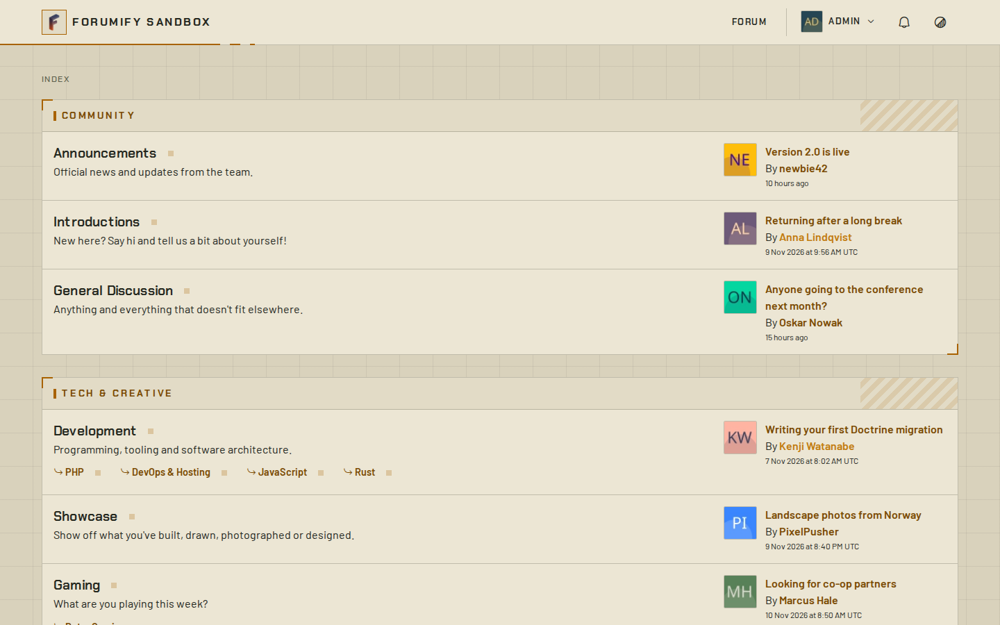 | 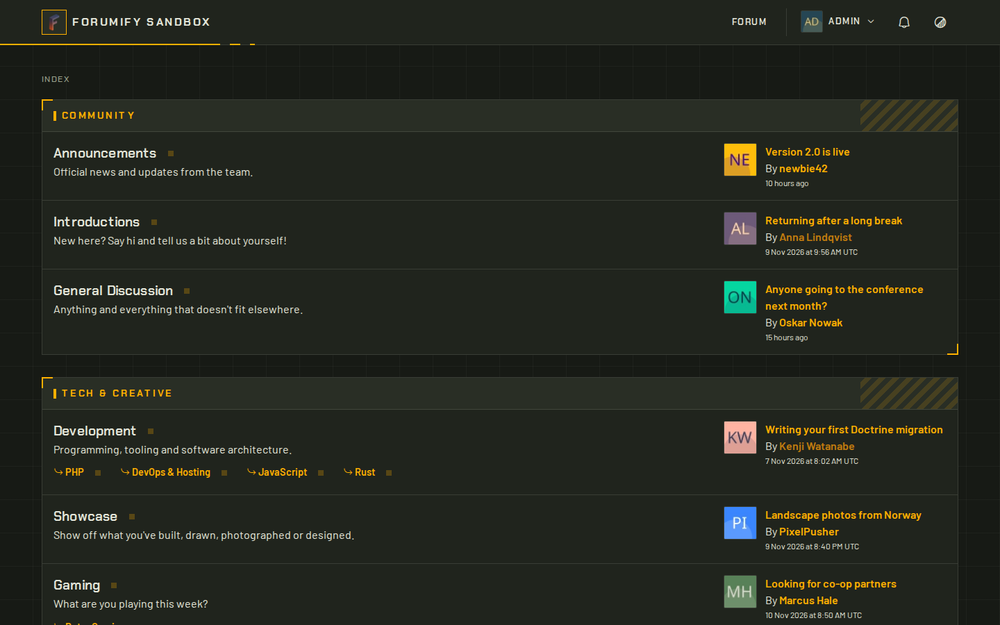 |
| 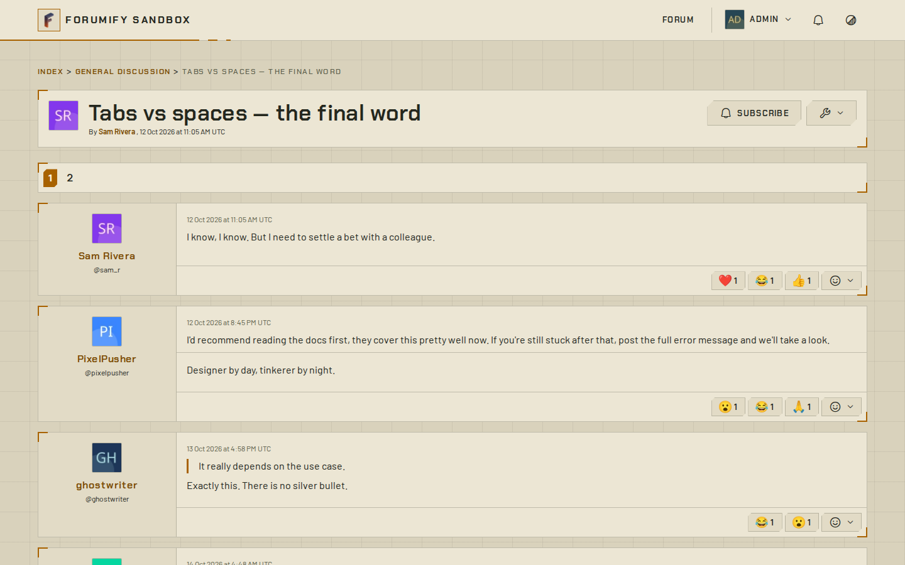 | 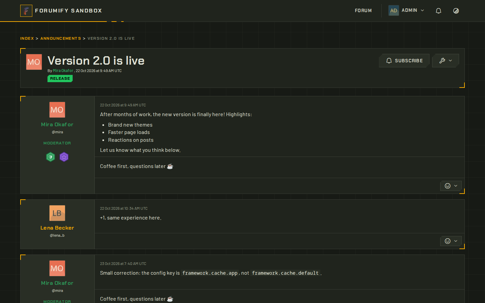 |
| 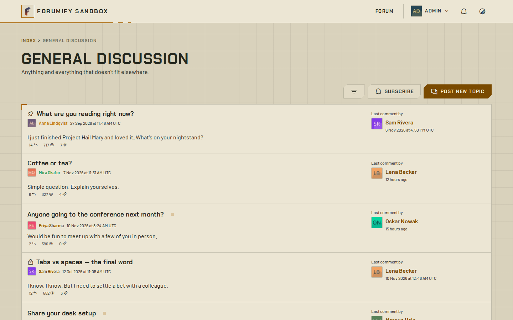 | 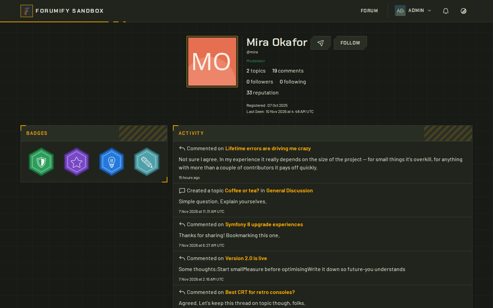 |
| 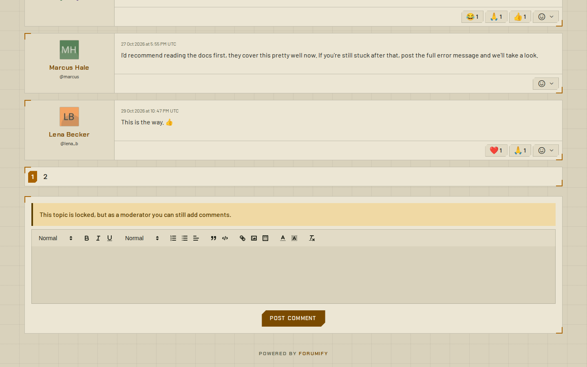 | 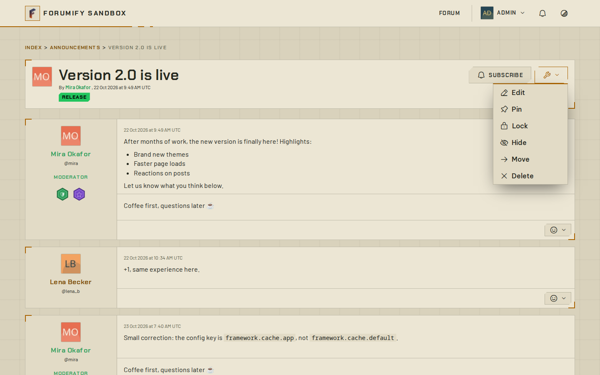 |
| 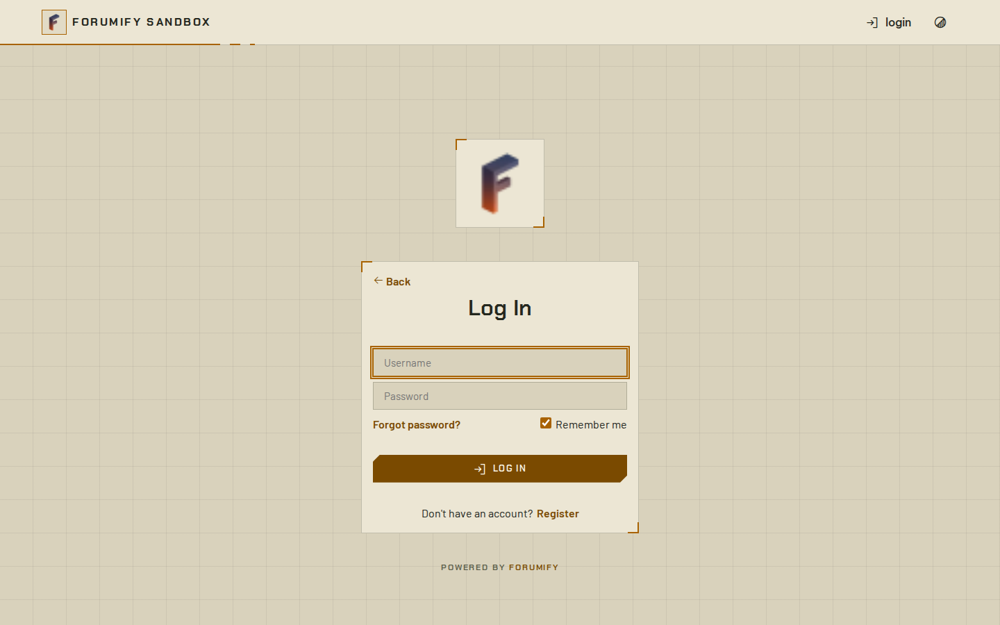 | |

| Phone | Phone menu |
| --- | --- |
| 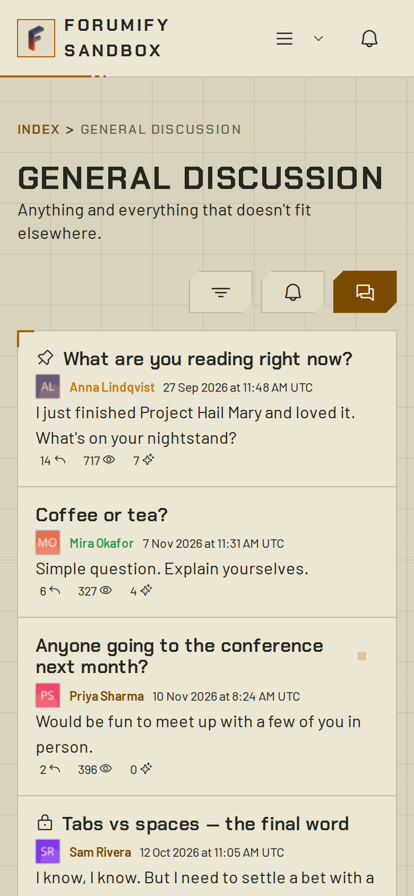 | 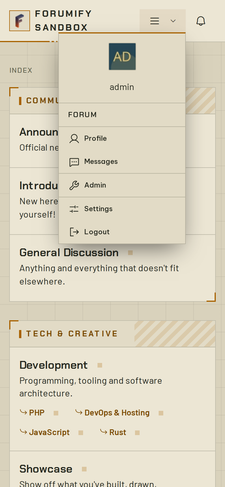 |

## How it is built

The theme only styles forumify's own CSS framework: `box`, `card`, the `btn-*` buttons,
menus, form fields, tables, tabs, tags and alerts, plus the forum's own building blocks.
It overrides no templates. Pages added by forumify updates or by plugins are built from
the same classes, so they pick up the look without any extra work.

Every colour comes from a theme variable. forumify writes the light or dark set of
variables depending on the visitor's preference, and the stylesheet never needs to know
which one is active. forumify's own variables keep their meaning (the admin panel uses
them too), only their defaults change.

## Theme variables

On top of forumify's own colours, borders and font size, the theme adds these. All of
them can be changed under **Admin → Settings → Themes**, separately for dark mode.

| Variable | What it does |
| --- | --- |
| `recon-signal` | Corner brackets, active states and the HUD line |
| `recon-signal-text` | Text on top of the signal colour |
| `recon-grid` | Colour of the map grid, `transparent` hides it |
| `recon-grid-size` | Size of a grid square |
| `recon-chamfer` | How much is cut off the corners of buttons |
| `recon-bracket` | Length of the corner brackets on panels |
| `recon-display-font, recon-font` | Heading and body fonts |
| `color-scheme` | `light` or `dark`, so native controls and scrollbars match |

## Requirements

- PHP 8.4 or newer
- Composer

## What's in here

```
src/
  ReconTheme.php   Theme class: name, author, stylesheets, variables
public/
  style.css               Loaded on every page while the theme is active
templates/                Overrides for forumify's and plugins' templates
```

Two things in `composer.json` make it a theme:

```json
{
    "type": "forumify-theme",
    "extra": {
        "forumify-plugin-class": "Forumify\\ReconTheme\\ReconTheme"
    }
}
```

forumify discovers installed themes by that package type, and reads the class named in
`extra` for the theme's name, stylesheets and variables.

## Variables

Your theme class extends forumify's base theme, so it starts out with every variable
forumify's own styles rely on: colours, elevations, borders and font size. Admins can
change all of them under **Admin → Settings → Themes**, with separate values for dark
mode.

Add your own by overriding `getThemeConfig()`, the docblock on your theme class shows
how. Each variable becomes a CSS custom property:

```css
.header {
    background-color: var(--c-header);
}
```

## Stylesheets and other static files

Everything in `public/` is linked into the forumify instance at
`public/themes/forumify/recon-theme/` when the theme is installed or refreshed.
Stylesheets listed in `getStylesheets()` are loaded on every page, anything else
(images, fonts) can be referenced relative to them.

Using an asset builder for sass or similar? Keep the sources in `assets/` and build into
`public/`: only `public/` reaches the forumify instance.

## Overriding templates

Templates in `templates/` replace forumify's own. The first directory is `Forumify` for
core templates, or the plugin class name for a plugin's templates:

```
templates/Forumify/frontend/forum/list.html.twig
templates/AcmeCalendarPlugin/frontend/calendar.html.twig
```

Extend the original with the `@!` prefix and override only the blocks you need, so your
theme keeps working when forumify updates the template:

```twig



    <div class="flex gap-4">
        {{ parent() }}
    </div>

```

Missing a block you need? Add it to the original template and open a pull request on the
[platform repository](https://github.com/forumify/forumify-platform).

## Developing against a forumify instance

Point a local forumify instance at your working copy with a path repository, so your
changes are live without publishing anything:

```bash
cd /path/to/your/forumify-instance
composer config repositories.recon path /path/to/recon
composer require forumify/recon-theme:@dev
```

The theme then shows up under **Admin → Settings → Themes**, where you can activate it.
If it doesn't, refresh the plugin list:

```bash
php bin/console forumify:plugins:refresh
```

## Code quality

```bash
make quality        # phpcs + phpstan
make quality-fix    # fix what phpcs can fix automatically
```

## Publishing

1. Push the repository to GitHub.
2. Submit it to [Packagist](https://packagist.org/packages/submit).
3. Tag a release. Users install it with
   `composer require forumify/recon-theme`.

## Documentation

- [Theme guide](https://docs.forumify.net/guides/theme)
- [Customization guides](https://docs.forumify.net/guides/customization/introduction)
